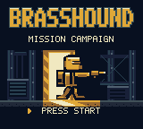
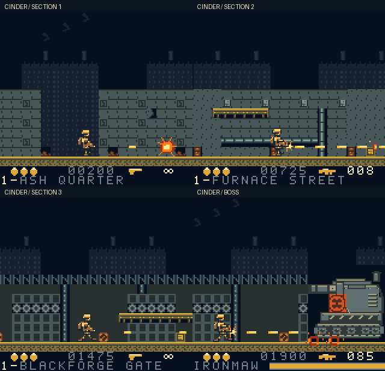
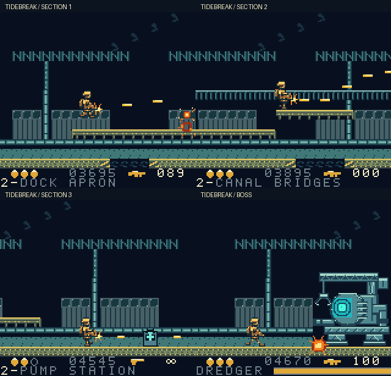
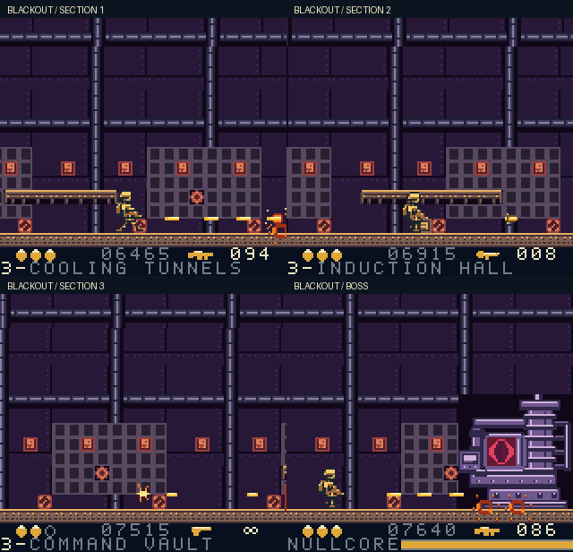

# BRASSHOUND — three-mission campaign

[](https://github.com/Carraway-and-Gatsby/chromatic-brasshound/actions/workflows/rom-self-check.yml)

An original run-and-gun Game Boy Color game. ROOK disables BLACKFORGE's rogue
weapons network across a ruined city, an industrial harbor and a command reactor.

**Download ROM:** [latest release](https://github.com/Carraway-and-Gatsby/chromatic-brasshound/releases/latest) — 32 KiB, CGB-only, no cartridge RAM.
**Build output:** `build/BRASSHOUND.gbc`.
**Browser preview:** run `make play`, then open http://127.0.0.1:8765.
The browser shows the actual cartridge's PyBoy framebuffer and APU sound.
The cartridge works entirely offline; the preview also works offline after setup.



Development snapshot: three continuous missions, original 16x24 ROOK sprites,
three bosses, sound and music. Emulator verification passes; physical Chromatic
hardware and human first-play pacing remain unverified.

<details>
<summary>Actual cartridge screenshots: all three stages</summary>





These are actual 160x144 PPU captures, enlarged2x with nearest-neighbor.
They were reached with ordinary campaign inputs and no memory writes.

</details>

## Campaign

| Mission | Environment and encounters | Boss |
|---|---|---|
| 1 — OPERATION CINDER | Ruined city, introductory patrols, factory batteries and drones | IRONMAW: armored cannon, faster three-height second phase |
| 2 — OPERATION TIDEBREAK | Harbor gantries, water gaps, suspended bridges and elevated batteries | DREDGER: dock cannon plus a telegraphed falling depth charge |
| 3 — OPERATION BLACKOUT | Enclosed reactor, coolant pipes, vent timing and combined defenses | NULLCORE: height-locked scan shot plus a second-phase projectile fan |

Clear a boss, then press **A** on Mission Complete to continue. After NULLCORE,
Campaign Complete allows A to replay all three missions. START returns to title
from a result screen. Scores and remaining weapon ammunition carry between
missions; each new mission restores HP and supplies at least 50 MG rounds/four
rockets. Boss checkpoints restore HP, 100 MG rounds and eight rockets.

Deaths retry the current mission. Before its boss checkpoint, retry restores
that mission's starting inventory/score; after the checkpoint, retry starts its
boss arena. Mission boundaries clear projectiles, encounter slots and old scenery.

## Build and run

Build requirements: Make, curl and Python 3.12 or newer on macOS/Linux.
GBDK-2020 4.5.0 and the pinned PyBoy environment are installed inside the
project by `make setup`; downloaded tools and virtual environments are ignored.

```sh
git clone https://github.com/Carraway-and-Gatsby/chromatic-brasshound.git
cd chromatic-brasshound
make setup
```

```sh
make                 # build/BRASSHOUND.gbc and .noi/.map debugging symbols
make play            # localhost browser emulator; Ctrl-C stops it
make test            # gameplay, browser, native UI and ROOK pose regressions
make assets          # regenerate original native 2bpp assets and previews
```

For a fresh macOS/Linux source checkout, install Make, curl and Python 3.12 or
newer, then run `make setup`. It downloads official GBDK 4.5.0 and installs pinned
emulator dependencies inside this project, without changing system packages.
A separate compiler can be selected with `make GBDK_HOME=/absolute/path/to/gbdk`.

The ROM can be opened directly in a GBC emulator. PyBoy 2.8.1 is the verified
emulator used here. No browser, Python or network is required by the cartridge.

## Controls

| Cartridge | Browser | Action |
|---|---|---|
| Left / Right | Arrows | Move and face left/right |
| Up | Up arrow | Aim vertically upward |
| Down | Down arrow | Crouch on a surface |
| A | Z | Jump; next mission / retry / replay on results |
| B | X | Fire; hold for repeat |
| START | Enter | Start / pause / resume; title from results |
| SELECT | Shift | Cycle weapons with ammunition |

Touch controls are available. Click Enable sound or press a game key to permit
browser audio. Short browser presses are latched for at least three emulated
frames so quick taps cannot vanish between emulator updates.

## Implemented systems

- Running, jumping, crouching, upward aiming, simultaneous movement/jump/fire,
  native animations, muzzle flashes, hit flashes, impacts and explosions.
- Unlimited pistol, limited-ammo MG and six-damage rockets; destructible supplies,
  healing/weapon pickups, five-digit campaign score and three-hit health.
- Patrol infantry, stationary batteries, hovering drones, elevated defenses,
  deterministic firing cues, bounded shot pools and invulnerability after damage.
- Three authored missions totaling 9,472 world pixels, 36 one-way platforms,
  12 gaps and eight cyclic vents. Each mission has three sections and an arena.
- Three distinct 64×64 tile bosses, open-core timing, two phases each, destruction,
  mission transition, campaign completion, retry and pause/resume.
- Original native 2bpp graphics, three environment palettes, ten sound effects and
  six original music loops including harbor and reactor themes.

## Evidence and limits

The selected ROOK title/HUD design is implemented as native 2bpp art. The title
has an original large wordmark, ROOK in a factory doorway and one START action.
The bottom 16px HUD groups three health pips, subdued score, a weapon silhouette
and ammo; the pistol shows infinity. Boss HP is a continuous 96px bar.

All 18 gameplay cases, four browser input checks, 11 UI regression checks and
six ROOK pose/collision checks passed. The ordinary-input campaign clears all three missions with zero memory
writes. Current timing, retries and sprite occupancy are recorded in the report.
UI fixtures separately cover 0..3 HP, ammunition up to 999, all three boss bars,
pause/resume and title-to-game tile integrity. [ROOK review](docs/rook-review.md) records
the native character review and real emulator captures.

ROOK has been redrawn directly at 16x24: brass helmet, dark visor, separate
pack/armor/boots, four running phases, a braced firing pose, tucked jump and
compact crouch. The original foot anchor and forgiving torso/leg hurtbox remain;
vertical projectiles and muzzle flashes follow the new rifle. Shared foot tiles
keep the complete OBJ atlas at 128 patterns, below signed BG storage. The
[ROOK review](docs/rook-review.md) includes matched before/after
cartridge crops, an actual-PPU running GIF and all-stage captures. Reproduce the
pose/collision evidence with `tools/emulator-venv/bin/python tests/rook_test.py`.

Stage assets were refined against fresh cartridge captures: factory silhouettes,
quieter metal walls, corrugated harbor containers, recessed water/open shafts,
and steel weapon/medical field cases. Geometry and encounters remain unchanged.
The [stage asset review](docs/stage-asset-review.md) includes each
stage's three sections/boss and before/after comparisons. Regenerate ordinary-input
stage screenshots with:

```sh
tools/emulator-venv/bin/python tools/capture_stages.py --output build/stage-screens
```

See [TESTING.md](TESTING.md) and the [published campaign report](docs/verification/campaign/report.json)
for the verified build. Running `make test` writes fresh results under `build/`. Ordinary-input progression
and isolated memory-assisted boundary fixtures are identified separately.

GitHub Actions runs the same build and self-checks on main pushes, pull requests
and manual dispatch. Each run validates the cartridge, verifies generated asset
sources, runs all emulator suites, and retains ROM/debug evidence for 14 days,
including failure screenshots and reports. The job summary shows that run's
results. See the [workflow](.github/workflows/rom-self-check.yml).

Busy updates can miss a VBlank, so this is not a locked 60 Hz claim. The camera
advances forward with limited retreat. Rockets cause direct damage and visible
explosions, without area damage. Enemy archetypes are shared across missions;
layout, elevation, hazards, scenery, music and boss patterns differ. There is no
save system; START/title or power-off begins a new campaign. Human first-play
pacing and native physical hardware compatibility remain unverified.

GBDK/C provides direct combat and hardware control. No cartridge was flashed.
Follow the hardware procedure in TESTING.md before native testing.

Source/level definitions are in `src/main.c`, `src/missions.c` and `include/missions.h`.
See [GAME_DESIGN.md](GAME_DESIGN.md), [art provenance](assets/PROVENANCE.md),
[audio source](assets/audio/README.md), and the original `docs/PROJECT_BRIEF.txt`.

## License and tooling

BRASSHOUND project source, original art and music are licensed under the
[MIT License](LICENSE).
Dependency licenses remain their upstream licenses. See [THIRD_PARTY.md](THIRD_PARTY.md).
