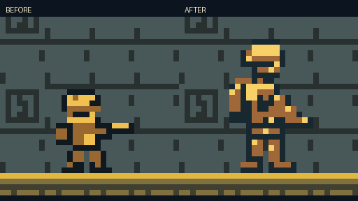

# ROOK native asset review

Verified build: `940e6b886e5576c5aaa2910192939e9b471b5705ba6a71cd3978657540265d63`. Source recipes are in
`tools/generate_assets.py`; exact indexed drawings are in `assets/source_art.json`.

ROOK was redrawn from16x16 to16x24 to separate the helmet/visor, pack, armor,
forearm, compact rifle and boots. Running has four phases; recoil has a braced
upper pose. Jump tucks the knees; crouch/death stay16x16. Original foot anchoring,
jump/landing physics and the forgiving torso/leg hurtbox are preserved. Normal,
crouched and vertical shots/muzzle flashes follow the rifle; vertical tracers
reuse spare pairs rather than extra projectile slots. Damage clears firing recoil.

[Ordinary-input pose sheet](verification/rook/ordinary-poses.png) ·
[Actual-PPU running GIF](verification/rook/run-live.gif) ·
[ROOK check report](verification/rook/report.json)

These are native cartridge captures, enlarged with nearest-neighbor only.
Five pose groups use ordinary controls and zero WRAM writes; the sixth uses
explicitly labeled collision fixtures for torso hits, crouch avoidance, hurt
and lethal damage. Native previews in `assets/` are illustrative, not PPU claims.

The atlas uses214 BG /128 OBJ /206 title BG patterns. Standing ROOK uses four
hardware sprites with transparent lower padding; crouch/death and other actors
use two. Shared foot patterns keep OBJ data at0x8000..0x87FF, below signed BG
storage at0x8800. A bounded critical render commits shadow OAM before DMA.

18 gameplay cases,4 browser quick-tap checks,11 UI checks and6 ROOK checks pass.
The input-only three-mission campaign clears in225.89s,
0 retries, zero memory writes. Every-frame OAM peak15,
scanline peak10, overflow0.
The cartridge stays32KiB. See [TESTING.md](../TESTING.md).

Further palette/pose polish is possible. Busy frames may miss VBlank; physical
Chromatic-screen review and human first-play pacing remain unverified.
